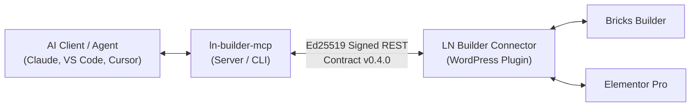

# LN Builder Connector

[](https://wordpress.org)
[](https://php.net)
[](LICENSE)
[](#)

**LN Builder Connector** (`ln-builder-connector`) is a secure, high-performance WordPress plugin that bridges modern page builders (**Bricks Builder** & **Elementor Pro**) with AI assistants, CLI agents, and Model Context Protocol (MCP) servers.

---

## Architecture Overview



### The Problem It Solves
Traditional AI-assisted WordPress workflows dump raw, unstyled JSON with hardcoded fonts and inline colors directly onto the site, causing style drift and code bloat.

**LN Builder Connector solves this by:**
1. **Extracting Design Context:** Exposes active brand palettes, typography scales, CSS variables, and components without leaking internal database IDs.
2. **Builder-Neutral Tree Format:** The AI generates structured, semantic content trees rather than vendor-specific JSON blobs.
3. **Atomic Writes & Rollbacks:** The connector validates, sanitizes, and writes templates/pages directly into your builder, creating automated point-in-time snapshots before any mutation.

---

## Core Capabilities

* **Cryptographic Security (Ed25519 & RFC 9421):** Every API mutation is signed with asymmetric Ed25519 keys, verified using PHP's native `ext-sodium`. Replays and request tampering are blocked via JTI tracking, timestamps, and hash checks.
* **Dual Builder Adapters:**
  * **Bricks Builder 2.2+**: Full support for sections, containers, elements, global classes, and CSS custom variables.
  * **Elementor Pro 3.x**: Support for container flexbox structures, templates, and global styles.
* **Granular Scopes:** Strict RBAC with `read`, `content:write`, `publish`, and `design:write` permissions.
* **Audit Trail & Attribution:** Every change records the acting user (`act`), human-readable name (`name`), organization (`org`), and session ID (`sid`) in both post meta and custom database audit logs.
* **Dynamic JWKS Support:** Connect flow with remote key discovery and automatic daily cache refreshing.
* **Instant Rollbacks:** Atomic snapshot engine stores pre-mutation states in `wp_ln_builder_snapshots`, enabling instant recovery from any undesired change.

---

## Requirements

* **WordPress:** 6.4 or higher
* **PHP:** 8.1 or higher with `ext-sodium` enabled
* **Page Builder:** Bricks 2.2+ or Elementor Pro 3.x

---

## Installation

### Via Zip / Git Clone
1. Clone or download this repository into your WordPress plugins directory:
   ```bash
   cd wp-content/plugins/
   git clone https://github.com/live-networks/ln-builder-connector.git ln-builder-connector
   ```
2. Activate the plugin in **WordPress Admin &rarr; Plugins**.
3. Open the **LN Builder** menu in the WordPress sidebar to view status and connect to your MCP server.

---

## REST Endpoints (`/wp-json/ln-builder/v1`)

| Method | Endpoint | Required Scope | Description |
| :--- | :--- | :--- | :--- |
| `GET` | `/status` | `read` | Plugin status, active builder, version & capabilities |
| `GET` | `/design-context` | `read` | Active tokens, classes, fonts, and theme styles |
| `POST` | `/templates` | `content:write` | Create a new builder template |
| `GET` | `/templates/{id}` | `read` | Retrieve a template in compact format |
| `POST` | `/pages` | `content:write` | Create a new page |
| `PATCH` | `/pages/{id}` | `content:write` | Update or patch page content |
| `POST` | `/publish` | `publish` | Publish a draft post/page |
| `GET` | `/snapshots` | `read` | List snapshots for an entity |
| `POST` | `/snapshots/{id}/restore` | `content:write` | Rollback an entity to a snapshot |
| `GET` | `/audit` | `read` | Query audit log with actor/org/session filtering |

---

## License

This software is released under the **GNU General Public License v2.0 or later** (GPL-2.0-or-later). See [LICENSE](LICENSE) for details.
